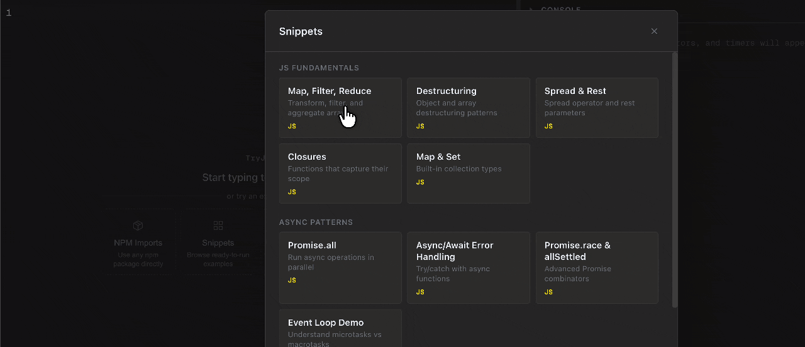
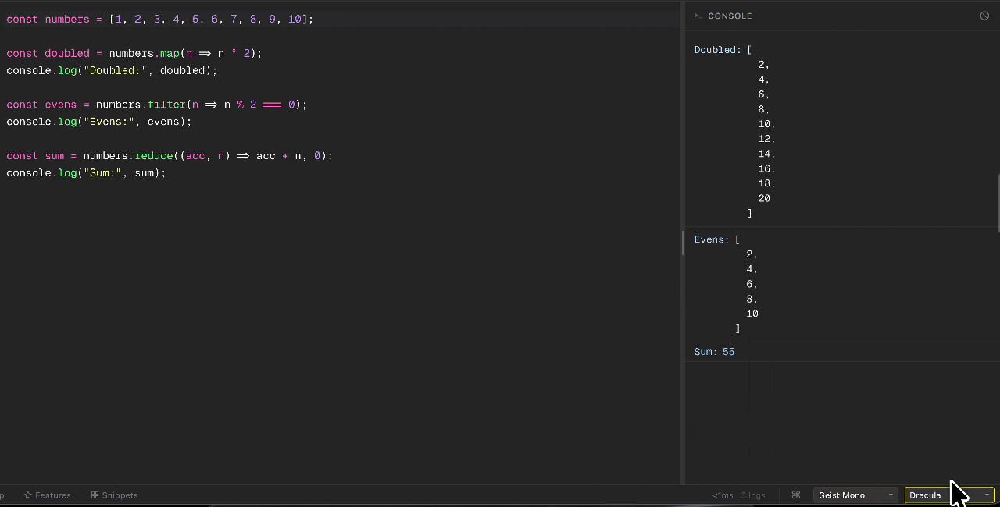
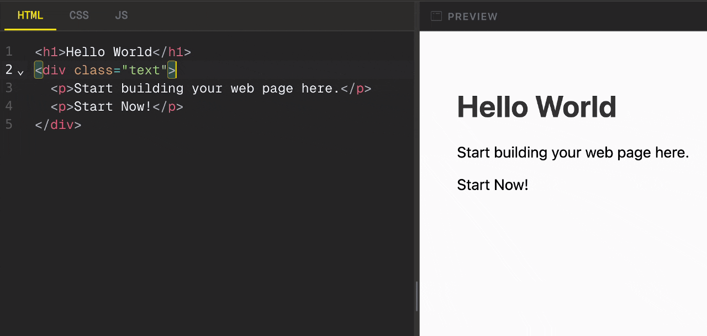
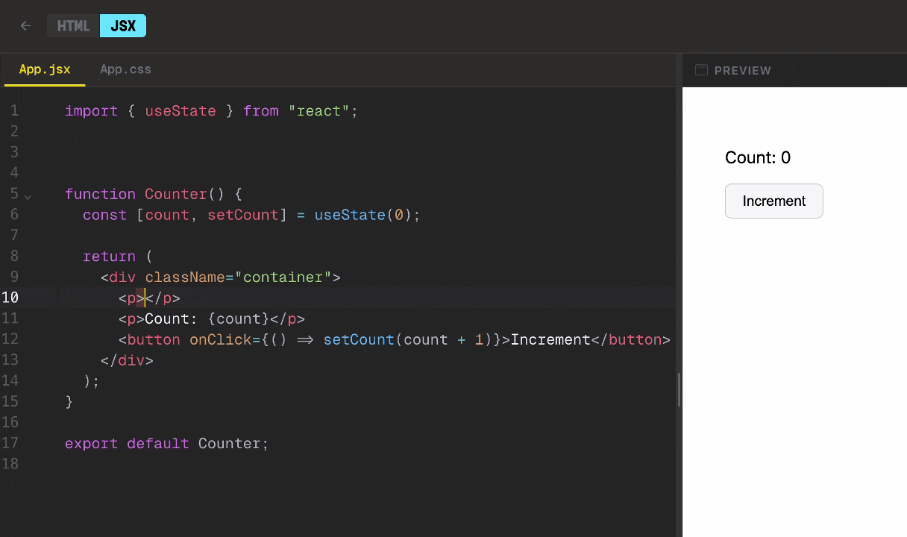
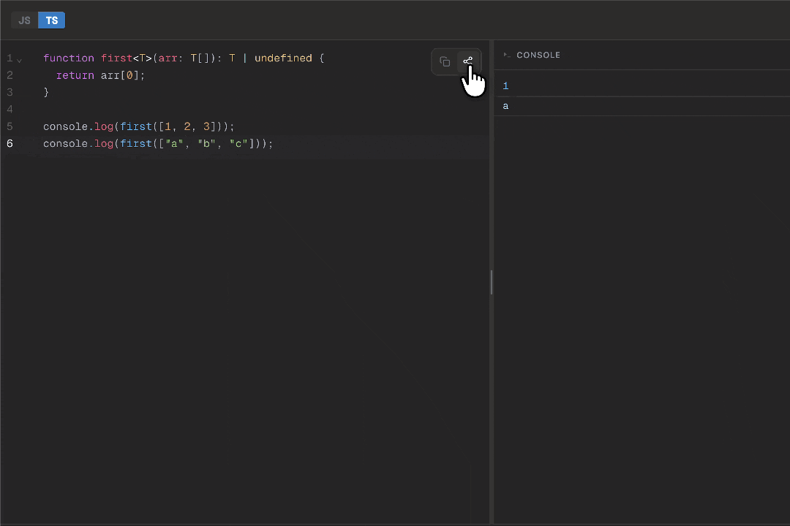

# TryJS

A fast, free JavaScript & TypeScript playground that runs entirely in your browser. Write code, see output instantly — no setup, no backend.

**Live:** [tryjs.app](https://tryjs.app) · **Features:** [tryjs.app/features](https://tryjs.app/features)

## Features

### JavaScript & TypeScript Playground



- **Instant execution** — code auto-runs on change with configurable debounce; `Cmd+Enter` runs immediately
- **JavaScript & TypeScript** — toggle with one click; TypeScript is transpiled in-browser via Sucrase
- **NPM imports** — browser-compatible packages, versioned imports (`zod@4.1.0`), scoped packages, and literal dynamic imports are resolved through [esm.sh](https://esm.sh)
- **REPL-style evaluation** — bare expressions display their result in the console, like Chrome DevTools
- **Object inspector** — expand objects, arrays, Maps, and Sets inline
- **Console output** — supports `log`, `warn`, `error`, `info`, `table`, `time`/`timeEnd`, and `clear`
- **Copy output** — each console row has a Copy action on hover, keyboard focus, or touch, including Web and React consoles; copies captured output as plain text, preserving serialization placeholders when full data is unavailable
- **Jump to errors** — click a JS/TS error's line and column (or focus it with Tab and press Enter/Space) to focus and reveal the source, including on mobile; TypeScript, npm imports, and async errors map back to your code
- **Sandboxed execution** — code runs in an iframe sandbox with a 5-second timeout (15s for module loading)

### Themes & Editor Customization



- **6 syntax themes** — One Dark, One Light, Dracula, GitHub Light, Monokai, Solarized Dark
- **3 editor fonts** — Geist Mono, Fira Code, JetBrains Mono
- **Optional Vim keybindings** — enable Vim from the status bar in JS, TS, HTML, CSS, and JSX editors; standard editing remains the default, and the Vim extension loads only when enabled
- **Persistent preferences** — syntax theme, editor font, Vim mode, and split position are remembered in this browser

### Web Playground (HTML/CSS/JS)



- **Vanilla mode** — tabbed HTML/CSS/JS editor with a live iframe preview and built-in console drawer

### React Playground



- **React mode** — write JSX components with a CSS tab, normal ES module imports, and a pinned React 19 runtime from esm.sh; dependency imports use the shared React runtime, with render errors surfaced in the preview and console

### Code-to-PNG Export



- **Export as image** — generate code screenshots with syntax themes, Safari/minimal frames, padding options, and gradient backgrounds (download PNG or copy to clipboard)

### Editor & IntelliSense

- **Format code on request** — choose **More options → Format code**, or press **Shift+Alt+F** (**⇧⌥F** on Mac) while editing. It formats the active JS, TS, HTML, CSS, or React tab, including with Vim enabled; one Undo restores the original code. Selection and scroll position are preserved where possible. Formatting is never automatic and does not save a named playground: it follows the usual draft and unsaved-change behavior.
- **Local, lazy formatter** — [Prettier standalone](https://prettier.io/docs/browser) and the needed language parsers load on the first formatting request. Source code stays in the browser. Invalid syntax leaves the document unchanged with an error message; edits, selection changes, or switching documents/tabs while loading discard the pending result.
- **Smart code completions** — 60+ snippet templates (`fn`, `cl`, `map`, `tc`, `imp`, `ust`, `uef`, `rfc`…), global API dot-access (`console.`, `Math.`, `JSON.`, `Object.`, `Array.`, `Promise.`, `document.`), and heuristic type inference for string/array/promise instance methods
- **TypeScript Language Service** — real type-aware IntelliSense powered by `ts.createLanguageService()` with `getCompletionsAtPosition()` for semantic completions
- **Hover type info** — hover over any identifier to see its type signature and documentation via `getQuickInfoAtPosition()`
- **TypeScript type checking** — official ES2024 and DOM declarations replace hand-written built-ins; semantic diagnostics run in a lazy-loaded local worker so compiler work stays off the editor thread
- **Package types** — automatic type acquisition retrieves available npm declarations and feeds both completions and hover information; package downloads are bounded, and unavailable declarations remain visible as diagnostics
- **npm import suggestions** — type `import ... from "` to get suggestions from 50+ popular packages (lodash, zod, dayjs, axios…)
- **React/JSX completions** — hooks (`useState`, `useEffect`…), JSX attributes (`className`, `onClick`…), and component scaffolding snippets

### Snippet Gallery

- **Ready-to-run examples** — organized by category: JS Fundamentals, Async Patterns, TypeScript Essentials
- **Gallery page** — browse all snippets at `/snippets` with category filtering
- **Detail pages** — individual snippet pages at `/snippets/:slug` with code, explanation, and related snippets
- **Load into playground** — one-click to load any snippet directly into the editor

### Share & Export

- **Share as URL** — JS, TS, Web, and React links preserve code and CSS, including empty tabs; existing share links remain compatible
- **Download playground (.json)** — download the complete current playground for a portable TryJS file
- **Embed code** — generate a sandboxed iframe for any mode; the dedicated `/embed` route hides site chrome and keeps editor/output visible on small screens

### My Playgrounds

- **Optional saving** — start writing immediately; the quiet **My playgrounds** entry opens a compact panel with **Save current code…**, saved work, and file actions
- **Open saved work** — only an open named playground adds its name, save status, **Save changes** when needed, and **Close playground**; `Cmd/Ctrl+S` names new work or updates the open record
- **Return to your code** — closing a saved playground restores the normal editor from before it was opened, even after opening other saves or refreshing; named edits stay separate from normal language/mode drafts
- **Explicit changes** — leaving edited saved code offers save, leave without saving, or keep editing; row actions offer rename, duplicate, download, and delete
- **Portable files** — import playgrounds or download all saved playgrounds directly from the panel; imports add copies and never overwrite matching saved IDs
- **Earlier code** — code replaced by a shared link or example is identified by its language and a code preview before opening it
- **Storage safeguards** — failed saves report an error, cross-tab conflicts offer a copy, and delete has Undo inside the library and briefly after closing it; blocked draft storage falls back to memory and prompts for a JSON export
- Saved playgrounds stay in this browser. Clearing site data removes local saves, so export a separate backup for safekeeping. The library supports up to 50 playgrounds, up to 500,000 source characters each, within a 2 MB JSON budget.

### General

- **Resizable split pane** — drag the divider between editor and console; position persisted across sessions
- **Code persistence** — normal drafts stay in localStorage per language and mode; the open saved editor keeps its pending edits and return point in this tab across refreshes
- **Mobile support** — responsive layout with editor/console tabs on small screens
- **SEO** — dynamic meta tags, canonical URLs, JSON-LD structured data (schema.org) with breadcrumbs for all pages
- **Analytics** — privacy-friendly event tracking via Vercel Analytics

## Tech Stack

| Layer         | Choice                          |
| ------------- | ------------------------------- |
| UI            | Preact + Preact Signals         |
| Editor        | CodeMirror 6                    |
| TS Transpiler | Sucrase                         |
| TS Compiler   | TypeScript 5, lazy local worker, official library declarations |
| Package Types | Microsoft Automatic Type Acquisition + virtual filesystem |
| Build         | Vite                            |
| Hosting       | Vercel                          |

## Development

Requires Node.js 22.18+ in the Node 22 line (`.nvmrc`).

```bash
# Install the locked dependencies
npm ci

# Start dev server
npm run dev

# Regression tests, type-check & production build
npm run check

# Preview production build
npm run preview
```

GitHub Actions runs the checks and dependency audit on pushes and pull requests. The Vercel build command also runs `npm run check`, so a failing regression test stops the deployment build.

Error navigation uses a snapshot of the code, language, and document that produced each error. Editing the code disables old locations until another run; opening another playground cannot reuse its error locations. TypeScript diagnostics use their original coordinates. Runtime errors use the nearest frame in your own code, with source maps for TypeScript and column corrections for import rewrites and result capture. Dependency-only errors, timeouts, and errors without a trustworthy source position remain text. Browsers can report the start of an expression rather than the precise failing identifier; navigation follows that reported position. If a browser omits syntax-error coordinates, a parser location is used when available.

## Keyboard Shortcuts

| Shortcut    | Action               |
| ----------- | -------------------- |
| `Cmd/Ctrl+Enter` | Run JS/TS code             |
| `Cmd/Ctrl+S` | Name a playground or update its saved record |
| `Cmd/Ctrl+L` | Clear the active console        |
| `Tab`       | Accept completion    |

## Project Structure

```
src/
  app.tsx                # App root, routing, keyboard bindings
  components/
    Editor/              # CodeMirror editor, themes, extensions
      completions.ts     # Snippet, API, JSX, npm completion sources
      hover.ts           # Hover-to-see-type tooltip extension
      extensions.ts      # Editor extensions & autocompletion wiring
      themes.ts          # Syntax themes & completion icon styling
    Console/             # Console output display
    WebEditor/           # Tabbed HTML/CSS/JS editor for web mode
    WebPreview/          # Live iframe preview with console drawer
    ReactEditor/         # JSX + CSS tabbed editor for React mode
    ReactPreview/        # Live React component preview
    Toolbar/             # Language toggle, web/react mode switch, links
    StatusBar/           # Help, snippets, shortcuts, theme/font selects
    SplitPane/           # Draggable editor/console split
    Gallery/             # Snippet gallery modal
    Playgrounds/         # Named local saves, sharing, JSON backups, embed links
    Snippets/            # Snippet gallery & detail pages
    Screenshot/          # Export-as-image modal
    Toast/               # Toast notifications
    Features/            # /features landing page
  data/
    snippets.ts          # Snippet definitions with categories
  hooks/                 # useDebounce, useKeyboard
  sandbox/
    executor.ts          # Sandboxed code execution orchestrator
    transpiler.ts        # TypeScript/JSX transpilation via Sucrase
    type-checker.ts      # Lazy worker client for diagnostics
    typescript-worker.ts # Official TS libraries, package types, language service
    type-project.ts      # Virtual TypeScript filesystem and bounded type acquisition
    ts-completions.ts    # TS Language Service for completions & hover
  state/                 # Preact signals (editor, console, settings, UI)
  utils/                 # Share encoding, screenshot renderer, SEO, constants
```

## Further possibilities

Multi-file imports and public Gist loading remain candidates to validate against user requests and usage. Current development focuses on reliable execution, reusable local playgrounds, and sharing without adding account or project-management complexity.

Have an idea? [Open an issue](https://github.com/berkinduz/try-js/issues) — we'd love to hear it.

## License

MIT
