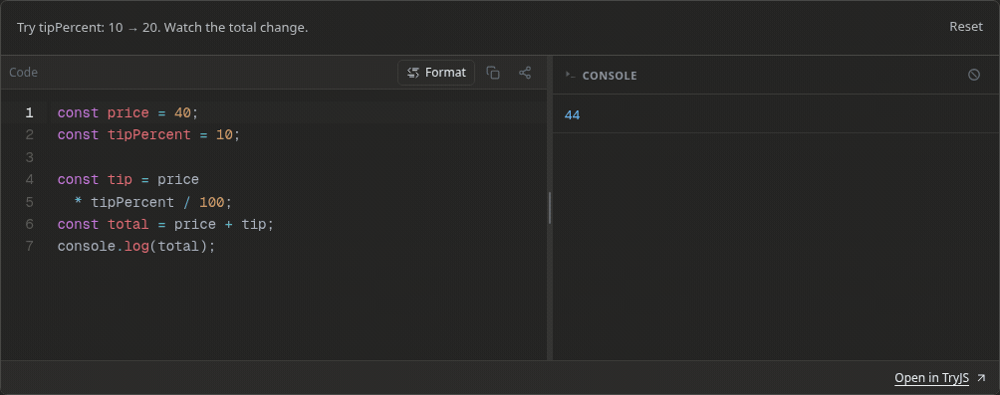

# TryJS

Open a tab. Write or paste some code. See the result.

A free, open-source playground for **JavaScript, TypeScript, HTML/CSS and React**. Paste code, change it, see the result. No signup or setup.

**[Open TryJS](https://tryjs.app/)** · [Explore examples](https://tryjs.app/snippets) · [Explore features](https://tryjs.app/features)

<a href="https://tryjs.app/features#use-cases"></a>

[Quick start](#getting-started) · [Try the live demos](https://tryjs.app/features#use-cases) · [Run locally](#local-development)

## Getting started

1. [Open the playground](https://tryjs.app/) and write or paste JavaScript.
2. Pause to let it run, or press **Cmd/Ctrl+Enter** to run immediately.
3. Inspect the output, change something, and see what happens.

Choose the workspace that fits the question:

| Workspace | What you can try |
| --- | --- |
| [JavaScript / TypeScript](https://tryjs.app/) | Run snippets, inspect the console and try browser-ready npm packages. |
| [Web](https://tryjs.app/web) | Edit HTML, CSS and JavaScript together with a live preview. |
| [React](https://tryjs.app/react) | Try JSX, hooks and CSS with a live React 19 preview. |

[Browse examples](https://tryjs.app/snippets) for JavaScript, TypeScript, React, Vue and Web APIs. Edit one right on the page, or open **Examples** in the editor.

## What can you use TryJS for?

- **Paste → check.** Try AI-generated code, change an input and inspect the answer.
- **Click → tweak.** Play with React state and watch the preview respond.
- **Break → share.** Turn a bug into a tiny example. Copy a link so someone else can try it.

[Your turn: try the live demos →](https://tryjs.app/features#use-cases)

<details>
<summary>Editor tools, sharing, saves and shortcuts</summary>

## Follow the result

- **Inspect values.** Bare JS/TS expressions show their result without `console.log`. Expand objects, arrays, Maps and Sets, or use `console.table` to compare rows.
- **Keep useful output.** Logs, warnings, errors and timers appear in the console. **Copy** on a row copies its captured output as plain text, including in Web and React consoles.
- **Go from an error to the code.** Click a JS/TS error's line and column to reveal its source. On mobile, this also opens the editor tab. Locations are offered when they can be mapped reliably to the current code; editing makes old locations inactive until the next run.

### Try an npm package

Use normal imports for browser-compatible packages. Versioned and scoped packages are supported, as are literal dynamic imports such as `import("dayjs")`.

Switch to **TS** and try this, or [open the example](https://tryjs.app/#v=2&code=JYWwDg9gTgLgBAbzgLzgXzgMyhEcBEyEAJgAIAsAdAIyUAM%2BA3AFDMDGEAdgM7wByEGAFM4AXhSUIAIwBWQtjAAUCZnDgwIYYGwBcE3lGCcA5ooCUAGlVwQRgK7Due5JU52QUoVHOVI3YDDAAG5C5lZoZizMMACeYCICwmISRpheADyx8RCYcIlCAHwsHDzwnIJCevnJ%2Bb4AhlDcoUgaWroEAAo4tk3c%2BBY29o561AAc6JGsJdwQADZClLMQpuXCkUA&lang=ts):

```ts
import { z } from "zod@4.1.0";

const Note = z.object({
  topic: z.string(),
  minutes: z.number().positive(),
});

type Note = z.infer<typeof Note>;
const note: Note = Note.parse({ topic: "Promises", minutes: 18 });

console.log(note);
```

The console shows `{ topic: "Promises", minutes: 18 }`. TypeScript adds type-aware completions, hover information and diagnostics in a local worker, using official JavaScript/DOM declarations and available npm package types.

## Sketch a browser interface

Open **Web** for HTML/CSS/JS, or choose **React** for JSX and CSS. The preview updates as you edit; open its console drawer to inspect logs and errors.

In React, export your component as the default export. Imports use a shared React 19 runtime, including dependencies that use React.

## Make the editor comfortable

- **Format when you choose.** Use **Format** above any editor, or **Shift+Alt+F** (**⇧⌥F** on Mac), for JS, TS, HTML, CSS or JSX. It formats the active tab, works with Vim enabled, and can be reversed with one Undo. Prettier and the needed parsers load on the first request; formatting runs in your browser and does not save a named playground.
- **Use familiar keys.** Optional **Vim** keybindings are available from the status bar. Standard editing is the default; the Vim extension loads when enabled.
- **Arrange your space.** Choose among six syntax themes and three editor fonts, and drag the divider to resize the panes. These preferences stay in this browser. Small screens use **Editor / Console** or **Editor / Preview** tabs.

## Share a working example

Open **Share** above the editor:

| Action | What it gives you |
| --- | --- |
| **Copy link** | A snapshot of the current JS, TS, Web or React playground, including CSS and empty tabs. Anyone with the full link can open its code. Copy a new link after making changes. |
| **Copy embed code** | An iframe using the dedicated `/embed` view, with the editor and output visible and site navigation removed. Useful for a runnable example in a post or documentation. |
| **Download playground (.json)** | A portable TryJS file you can import later or share as a file. |
| **Export as image** — JS/TS | A PNG of your code or selection, with syntax themes, window frames, padding and backgrounds. Download it or copy it to the clipboard. |

## Come back to an idea

Saving is optional. Normal drafts are remembered in this browser by language and mode, so you can keep trying code without naming anything.

1. Open **My playgrounds → Save current code…** when you want a named save.
2. Open it later from **My playgrounds**. Its name and save status appear above the editor; **Save changes** appears when you edit it. **Cmd/Ctrl+S** saves the open record, or asks for a name when working on a normal draft.
3. Use **Close playground** to return to the normal code you had before opening saved work, including after a refresh or opening other saves.

<p align="center">
  
</p>

Pending edits to a named playground stay separate from normal drafts and survive refreshes in the same tab. Before leaving edited saved work, choose to save, leave without saving, or keep editing.

The library supports rename, duplicate, delete with **Undo**, JSON import and download of all saves. Imports add copies rather than overwrite existing records; conflicting changes from another tab offer **Save a copy…**.

**Saves stay in this browser and are not synced between devices.** Clearing site data removes them. Download a JSON backup for work you want to keep separately.

## What to expect

- **Execution and editing happen locally.** TryJS runs code in sandboxed browser iframes. TypeScript/JSX transpilation, type checking and formatting also run in the browser.
- **Some features need the network.** npm modules load through [esm.sh](https://esm.sh/); available package declarations come from jsDelivr. Some editor tools load on demand. Imported libraries and code you run can make their own network requests.
- **The workspace is for small browser experiments.** It provides a JS/TS snippet, an HTML/CSS/JS set, or a JSX component with CSS. There is no Node.js runtime, terminal or local multi-file project. Packages must work in a browser.

## Keyboard shortcuts

Use **Cmd** on macOS and **Ctrl** on Windows/Linux. Editor shortcuts apply while the editor is focused.

| Shortcut | Action |
| --- | --- |
| **Cmd/Ctrl+Enter** | Run JavaScript or TypeScript immediately |
| **Shift+Alt+F** / **⇧⌥F** on Mac | Format the active editor tab |
| **Cmd/Ctrl+S** | Save the open named playground, or name the current code |
| **Cmd/Ctrl+L** | Clear the active console |
| **Tab** | Accept the selected completion |

</details>

## Local development

Use **Node.js 24 LTS** (`.nvmrc`). From a clone of this repository:

```bash
npm ci
npm run dev
```

Before submitting a change:

```bash
# Regression tests, TypeScript checks and production build
npm run check

# Dependency audit used by CI
npm audit --audit-level=high

# Serve the production build locally
npm run preview
```

GitHub Actions runs the checks and audit on pushes and pull requests. Vercel also runs `npm run check` before deploying.

Built with **Preact + Signals**, **CodeMirror 6**, **Sucrase**, **TypeScript**, **Prettier** and **Vite**.

```text
src/components/   Editor, consoles, previews, library and page UI
src/sandbox/      Execution, transpilation, source maps and type services
src/state/        Editor drafts, saved playgrounds and preferences
src/utils/        Sharing, storage, formatting and exports
src/data/         Runnable snippet definitions
tests/            Regression tests
```

Bug reports and focused contributions are welcome. [Open an issue](https://github.com/berkinduz/try-js/issues) with the code, expected result and browser details; a small shared example helps reproduce it.

## License

[MIT](LICENSE)
