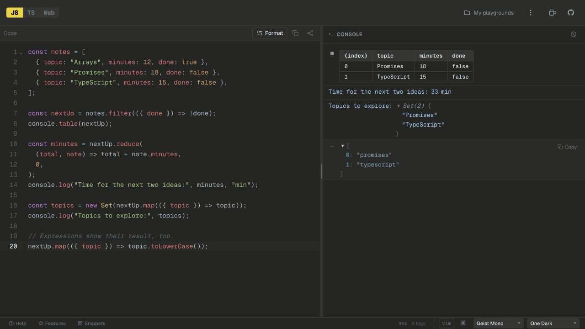
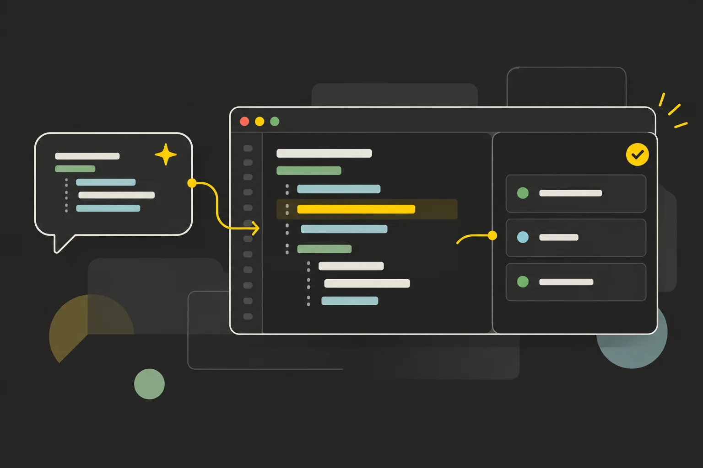
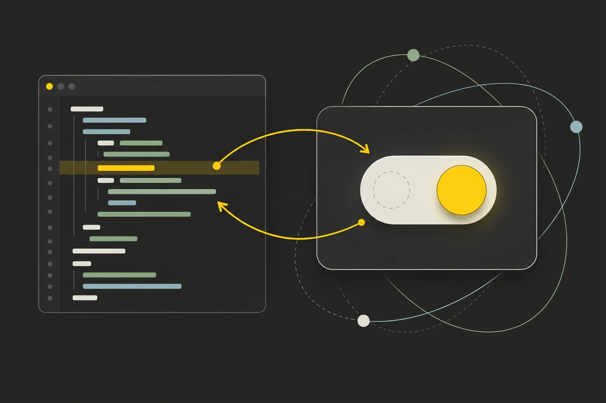
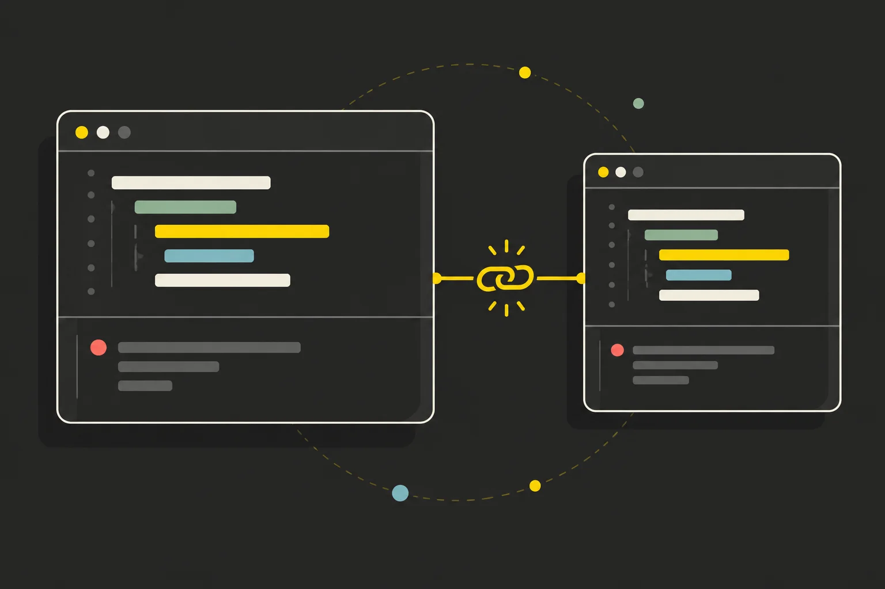
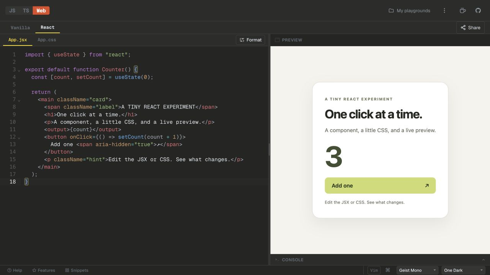
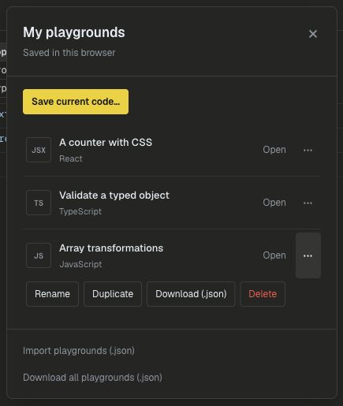

# TryJS

Open a tab. Write or paste some code. See the result.

TryJS is a free, open-source playground for JavaScript, TypeScript, HTML/CSS and React. Use it to check code from an AI assistant, explore a language or React feature, or share a small reproducible bug without setting up a project first. No account or installation required.

**[Open TryJS](https://tryjs.app/)** · [Explore examples](https://tryjs.app/snippets) · [Explore features](https://tryjs.app/features)



*Filter some data, inspect it, change it. [Open this example](https://tryjs.app/#v=2&code=MYewdgzgLgBGJQKYRgXhgbQFAxgbxihAAcBLYALhgCIBBAJ3oEMBPCagGhgFtSwBXJBCoBGAExcAJuERUo9fohgBfDjnyES5KtQAK9ELwjJOPPoOSiAHFJlUAZkwA2xlWtwEiZSjQAqLYkQAZWB6UmIoU14BIVEAVlswWRhHFyVVLABdAG4sLFBIWCSADygAVWI0OARkADp7UickegAKFoJpJJUASjQAPhgAQk7EbtyCiBAnRFqoJgAjaZaS8uIxvInYaIsUdBWK2vpESX5gRBb1FqI5py54JF7UAevnGABqaqRa7aF3GAAGNTrCZTGZOEAAcxa1F8pG4SnsIHohAAFkoVoQAO4gGCkSSIJjCKLmX40aLUdb5cDQTTeXZwRCYmBBRBQZaIUoHbhMYhtTxaYA9fq08jdYHU0G1cFQmEClBEGAc4jgo4UUxecgQSkAem1MAAosViEcIBBSNSYBAUSAmVA0aRkSb%2BE0uEQQLUsPtiN8eXyRYLlI9ngLZiAADI2xD0ADChPOYuyQA&lang=js).*

[Getting started](#getting-started) · [Use cases](#what-can-you-use-tryjs-for) · [Sharing](#share-a-working-example) · [Saving](#come-back-to-an-idea) · [Shortcuts](#keyboard-shortcuts) · [Development](#local-development)

## Getting started

1. [Open the playground](https://tryjs.app/) and write or paste JavaScript.
2. Pause to let it run, or press **Cmd/Ctrl+Enter** to run immediately.
3. Inspect the output, change something, and see what happens.

Choose the workspace that fits the question:

| Workspace | What you can try |
| --- | --- |
| [JavaScript / TypeScript](https://tryjs.app/) | Expressions, data transformations, async code, types and npm packages, with console output beside the editor. Use **JS / TS** to switch languages. |
| [Web](https://tryjs.app/web) | HTML, CSS and JavaScript in separate tabs, with a live page preview and a console drawer. |
| [React](https://tryjs.app/react) | A JSX component and its CSS, with hooks, npm imports and a live React 19 preview. |

Open **Examples** in the status bar or [explore the library](https://tryjs.app/snippets). Search by task, package or technology across JavaScript, TypeScript, React and Web examples, including Vue, Zod, CSS and Canvas. Each page has an editable playground, something to try, an expected result and readable source. Inline edits stay separate from your main drafts; **Open in TryJS** carries your current changes into the full editor. Package examples show the exact version they use.

## What can you use TryJS for?

### Check AI-generated JavaScript or TypeScript

Paste a snippet from ChatGPT, Copilot or another AI assistant into the playground. Change the inputs and compare the console output with the result you expected. Switch to TypeScript for type diagnostics, completions and hover information; follow a runtime error back to its source when a location is available.



[Check a JS / TS snippet](https://tryjs.app/) or [try a data-validation example with Zod](https://tryjs.app/snippets/zod-validation).

### Explore a React behavior before changing your app

Try a component's state, props or hooks in isolation. Edit its JSX or CSS and see the live React 19 preview update. Start with one interaction, change the behavior and bring what you learn back to your app. Browser-compatible npm imports are available when a small package helps answer the question.



[Open the React playground](https://tryjs.app/react) or [experiment with optimistic UI](https://tryjs.app/snippets/react-optimistic-ui).

### Share a small reproducible bug

Reduce a browser issue to the smallest JS/TS, HTML/CSS/JS or React example that still fails. Open **Share → Copy link** and include the link in an issue or conversation, together with the expected result. Someone else can open the same code and investigate it without recreating your project. The link carries a code snapshot; copy a new link after changing the example.



[Build a Web repro](https://tryjs.app/web) or [see the sharing options](#share-a-working-example).

## Follow the result

- **Inspect values.** Bare JS/TS expressions show their result without `console.log`. Expand objects, arrays, Maps and Sets, or use `console.table` to compare rows.
- **Keep useful output.** Logs, warnings, errors and timers appear in the console. **Copy** on a row copies its captured output as plain text, including in Web and React consoles.
- **Go from an error to the code.** Click a JS/TS error's line and column to reveal its source. On mobile, this also opens the editor tab. Locations are offered when they can be mapped reliably to the current code; editing makes old locations inactive until the next run.

### Try an npm package

Use normal imports for browser-compatible packages. Versioned and scoped packages are supported, as are literal dynamic imports such as `import("dayjs")`.

Switch to **TS** and try this, or [open the example](https://tryjs.app/#v=2&code=JYWwDg9gTgLgBAbzgLzgXzgMyhEcBEyEAJgAIAsAdAIyUAM%2BA3AFDMDGEAdgM7wByEGAFM4AXhSUIAIwBWQtjAAUCZnDgwIYYGwBcE3lGCcA5ooCUAGlVwQRgK7Due5JU52QUoVHOVI3YDDAAG5C5lZoZizMMACeYCICwmISRpheADyx8RCYcIlCAHwsHDzwnIJCevnJ%2Bb4AhlDcoUgaWroEAAo4tk3c%2BBY29o561AAc6JGsJdwQADZClLMQpuXCkUA&lang=ts):

```ts
import { z } from "zod@4.1.0";

const Note = z.object({
  topic: z.string(),
  minutes: z.number().positive(),
});

type Note = z.infer<typeof Note>;
const note: Note = Note.parse({ topic: "Promises", minutes: 18 });

console.log(note);
```

The console shows `{ topic: "Promises", minutes: 18 }`. TypeScript adds type-aware completions, hover information and diagnostics in a local worker, using official JavaScript/DOM declarations and available npm package types.

## Sketch a browser interface

Open **Web** for HTML/CSS/JS, or choose **React** for JSX and CSS. The preview updates as you edit; open its console drawer to inspect logs and errors.

In React, export your component as the default export. Imports use a shared React 19 runtime, including dependencies that use React.



*[Open this counter](https://tryjs.app/react#v=2&mode=react&css=FQAg3iBGD2AeC0BnAlgL2QOwOYC4rQCcATAUwPhlgG4QBfAKBiIE9x6QQBbAQwK0zwAGKuy6Z4ACxLIsEgC54AjIMEA3CSI5FkiAA4AbbszxYCyIppAHuAYxLxkckp0R47GJwUu7uRbdjwAJgAOXWpRSFsAa1NoAFcMIjwAYgAzABZUgGYSEktU6A94VO5OZH1jEERmRCdOeDjkABoq7gxEJDJkVMsbaH1CFMCANhDAxREGADobXiI2DgB3czkJPDKMAAplQQBSFvTlMIBKb19-XBAswLDLSJsYgnjElNS3u8JSAiUwqv7zEDJUjAgCsH2IZHgBF8yDirhAgUEtwicCQEl80EWQhAimGv3SSNggMCAE5ApBEYp0pN6FNDJASPpwCACkUUKgSEpCTRWXJ4ItpLIFCAAOwg4QgfQkOSeJA%2BGyYS5TRQg5w0PoDb6AkWKEXDEHcGgMCSKZm8pBoTlXG7USWYexSGTyJTKmhSmWQvS2RV4eBTQTpNVcXj8DBKdK-CUMXRmwp89lWqm3O0YB2C504qbDdX9QaA-XDEkgmxG%2BjxOS6OJyZnaPSGSqQAYPGg8PgCHGhIkS80JvB65PmgVO4UilRu%2B2SdPCiYgDV55LpQKZa6lyBVuSFBYgZZEVZcvaWWvWSqpKXhDgAKzhcm6zHgfQ8JA8eC9dgo0oFT8s3H0MgwDjqeF3E8M4-B9HEsl%2BRRO3BL4hFgyFoW0OE8BJZEOHuR5niSQEiDsEVgjyUQ5y1ZJAiyLJBGg-I4zwYYVBxCMiWqWpnAaZBejiAhEDzXRoEwED6AYNcZUKHAJGgVQyGZTDYgSHDkhsPxIGGPI6FpCQBOZVtQ3DSMQG7OMLQ5JRFGTWggA&code=JYWwDg9gTgLgBAbzgVwM4FMDKMCGN1wC%2BcAZlBCHAERTo4DGMVA3AFCvoAekscAJuhI5kAG3glkAO0bAIkuAGEIU-FAAUASkSs4cenNTwA2vpUAaOBhhKVAXTgBeFBmx50agAwa2OuLRjIUPJqvroAPCA4wPL0IjioqAByOCDoDlT0OFB8VAB8obpwYahgODFxCcmp6XEARugieQCCcAAqAJKJAJpwAEoAok0KrXD9ABoACv297QCy-YmtYQD0JWX5hYVhABYAjLkA8pIEscD0ANZweFdwMKDoAHQrexubRWC5LfrgcuiSMBYcHARMAYDARAQFJhMIDJHwbiCAG4EMC0RHAdAAdyeyw%2BBXCyhgYGQMFyCFM-0IK0JxNJ%2BKKtRJMDkcDkChBFwcCE0jlylnQ1mU-zUFPgAGo4LsNIRXm84E0%2BPDfkU1vIssAcABabbARV-dIwKDIdB5QDphCtVbKtstGWC5FbwmA9BUkik0lQdf88v0%2BKDbtsCAApTBjVlQRTQh5wTDoAiY7bXegJyQAc3QqBxeM2K0i0Ve3lYhCAA&lang=js) and change its JSX or CSS. The screenshot shows it after three clicks.*

## Make the editor comfortable

- **Format when you choose.** Use **Format** above any editor, or **Shift+Alt+F** (**⇧⌥F** on Mac), for JS, TS, HTML, CSS or JSX. It formats the active tab, works with Vim enabled, and can be reversed with one Undo. Prettier and the needed parsers load on the first request; formatting runs in your browser and does not save a named playground.
- **Use familiar keys.** Optional **Vim** keybindings are available from the status bar. Standard editing is the default; the Vim extension loads when enabled.
- **Arrange your space.** Choose among six syntax themes and three editor fonts, and drag the divider to resize the panes. These preferences stay in this browser. Small screens use **Editor / Console** or **Editor / Preview** tabs.

## Share a working example

Open **Share** above the editor:

| Action | What it gives you |
| --- | --- |
| **Copy link** | A snapshot of the current JS, TS, Web or React playground, including CSS and empty tabs. Anyone with the full link can open its code. Copy a new link after making changes. |
| **Copy embed code** | An iframe using the dedicated `/embed` view, with the editor and output visible and site navigation removed. Useful for a runnable example in a post or documentation. |
| **Download playground (.json)** | A portable TryJS file you can import later or share as a file. |
| **Export as image** — JS/TS | A PNG of your code or selection, with syntax themes, window frames, padding and backgrounds. Download it or copy it to the clipboard. |

## Come back to an idea

Saving is optional. Normal drafts are remembered in this browser by language and mode, so you can keep trying code without naming anything.

1. Open **My playgrounds → Save current code…** when you want a named save.
2. Open it later from **My playgrounds**. Its name and save status appear above the editor; **Save changes** appears when you edit it. **Cmd/Ctrl+S** saves the open record, or asks for a name when working on a normal draft.
3. Use **Close playground** to return to the normal code you had before opening saved work, including after a refresh or opening other saves.

<p align="center">
  
</p>

Pending edits to a named playground stay separate from normal drafts and survive refreshes in the same tab. Before leaving edited saved work, choose to save, leave without saving, or keep editing.

The library supports rename, duplicate, delete with **Undo**, JSON import and download of all saves. Imports add copies rather than overwrite existing records; conflicting changes from another tab offer **Save a copy…**.

**Saves stay in this browser and are not synced between devices.** Clearing site data removes them. Download a JSON backup for work you want to keep separately.

## What to expect

- **Execution and editing happen locally.** TryJS runs code in sandboxed browser iframes. TypeScript/JSX transpilation, type checking and formatting also run in the browser.
- **Some features need the network.** npm modules load through [esm.sh](https://esm.sh/); available package declarations come from jsDelivr. Some editor tools load on demand. Imported libraries and code you run can make their own network requests.
- **The workspace is for small browser experiments.** It provides a JS/TS snippet, an HTML/CSS/JS set, or a JSX component with CSS. There is no Node.js runtime, terminal or local multi-file project. Packages must work in a browser.

## Keyboard shortcuts

Use **Cmd** on macOS and **Ctrl** on Windows/Linux. Editor shortcuts apply while the editor is focused.

| Shortcut | Action |
| --- | --- |
| **Cmd/Ctrl+Enter** | Run JavaScript or TypeScript immediately |
| **Shift+Alt+F** / **⇧⌥F** on Mac | Format the active editor tab |
| **Cmd/Ctrl+S** | Save the open named playground, or name the current code |
| **Cmd/Ctrl+L** | Clear the active console |
| **Tab** | Accept the selected completion |

## Local development

Use **Node.js 22.18+ within the Node 22 line** (`.nvmrc`). From a clone of this repository:

```bash
npm ci
npm run dev
```

Before submitting a change:

```bash
# Regression tests, TypeScript checks and production build
npm run check

# Dependency audit used by CI
npm audit --audit-level=high

# Serve the production build locally
npm run preview
```

GitHub Actions runs the checks and audit on pushes and pull requests. Vercel also runs `npm run check` before deploying.

Built with **Preact + Signals**, **CodeMirror 6**, **Sucrase**, **TypeScript**, **Prettier** and **Vite**.

```text
src/components/   Editor, consoles, previews, library and page UI
src/sandbox/      Execution, transpilation, source maps and type services
src/state/        Editor drafts, saved playgrounds and preferences
src/utils/        Sharing, storage, formatting and exports
src/data/         Runnable snippet definitions
tests/            Regression tests
```

Bug reports and focused contributions are welcome. [Open an issue](https://github.com/berkinduz/try-js/issues) with the code, expected result and browser details; a small shared example helps reproduce it.

## License

[MIT](LICENSE)
